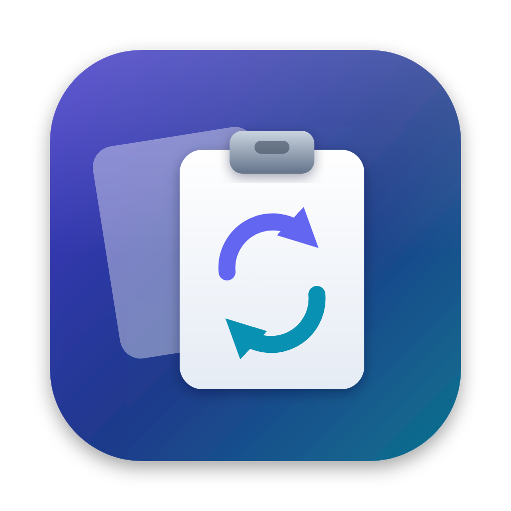

<p align="center"></p>

# ClipShare

**Share your clipboard between macOS and Linux.**

ClipShare is a native macOS menu bar app that syncs clipboard history with
[omaclip](https://github.com/rhemvi/omaclip), a clipboard manager for Linux. omaclip is built with
[Omarchy](https://omarchy.org) in mind but runs on most distributions (Arch, Debian/Ubuntu,
Fedora, openSUSE and others). Copy something on your Linux machine and paste it on your Mac with
one shortcut, or the other way around.

Linux keeps running stock omaclip, unchanged. ClipShare speaks omaclip's sync protocol (v2)
directly, so it replaces omaclip's own macOS build with something that feels at home on a Mac:
a small Swift/AppKit app that lives in the menu bar and stays out of the way.

## Features

- **Menu bar only.** No Dock icon and no window until you ask for one. The icon dims when no peer
  is connected, and its menu shows each peer's status.
- **History panel (⌥⌘V by default).** A Spotlight-style panel with everything copied on this Mac and on your
  Linux machines. Type to search; use ↑/↓ and Return, ⌘1–9 for quick picks, and Tab to switch
  between All / This Mac / Peers. Choosing an entry copies it and (optionally) pastes it into the
  app you were using.
- **Paste latest from Linux (⌃⌥⌘V by default).** Pastes the newest entry from any peer straight into the
  front app.
- **Auto-Copy from Peers.** An optional menu toggle that puts every new Linux copy onto the Mac
  clipboard as soon as it arrives.
- **Two-way.** The Mac shares its newest copies (5 by default) back to omaclip, so they show up in
  omaclip's remote clipboard list on Linux.
- **Text and images,** including image files copied in Finder (sent as the image itself, not its name).
- **Private by default.** It skips items that password managers mark as concealed or transient,
  keeps history in memory only, and stores the passphrase in the Keychain.
- **Customizable, layout-aware shortcuts.** Change either shortcut in Settings › Shortcuts.
  Shortcuts and the automatic paste follow your active layout (Dvorak, AZERTY, …) rather than
  physical QWERTY key positions.

## Requirements

- macOS 14 Sonoma or newer
- Xcode 16.3 or newer (Swift 6.1+ toolchain) to build
- omaclip v0.10 or newer (sync protocol v2) on your Linux machines

## Install

```bash
git clone https://github.com/JoelCranston/Clipboard_Share.git
cd Clipboard_Share
./scripts/build-app.sh --install   # builds, copies to /Applications, and launches
```

`./scripts/build-app.sh` on its own just builds `build/ClipShare.app`.

## Setup

1. On first launch, Settings opens. Enter the **same passphrase** you use for omaclip. If omaclip
   was ever set up on this Mac, ClipShare imports it from `~/.config/omaclip/config.json`
   automatically.
2. Allow **Local Network** access when macOS asks, so ClipShare can find omaclip and omaclip can
   reach the Mac.
3. To use automatic pasting (after choosing an entry, or with ⌃⌥⌘V), allow **Accessibility** access
   in System Settings › Privacy & Security › Accessibility. ClipShare only uses it to send ⌘V.
   Rebuilding re-signs the app ad hoc, so you may need to switch ClipShare off and on there after
   reinstalling.

### Same network

Nothing else to do. ClipShare and omaclip find each other with Bonjour/mDNS (`_omaclip._tcp`).

### Tailscale or other VPNs

mDNS usually doesn't cross VPNs, so give each side a fixed port and point them at each other:

```bash
# On Linux
omaclip --sync-server-port=36742 --peers-list=mac@100.64.0.2:36742
```

In ClipShare's Settings › Network, set the port to `36742` and the manual peers to
`omarchy@100.64.0.3:36742`, then click **Apply Network Settings**. Settings lists this Mac's
addresses and port so you can copy them into the omaclip command.

ClipShare's manual peers can use host names as well as IP addresses, for example
`omarchy@omarchy.local:36742` or a Tailscale MagicDNS name like `omarchy.tail1234.ts.net:36742`.
They're resolved to IPv4 every 30 seconds, so a peer whose address changes keeps working.
omaclip's own `--peers-list` on Linux only accepts IP addresses.

## How it works

Every peer runs a small HTTPS server, and peers poll each other every 2 seconds:

1. `GET /api/clipboard/checksum`: stop here if nothing changed.
2. `GET /api/clipboard`: a newest-first manifest (`id`, `checksum`, `contentType`,
   `imageMimeType`, `timestamp`) without payloads.
3. `GET /api/clipboard/{id}/content`: only for payloads not already held, each verified against
   its SHA-256.

Security comes entirely from the shared passphrase:

- Argon2id(passphrase, salt = passphrase reversed, t=1, m=64 MiB, p=4) gives a 32-byte key. Its hex
  goes in the `X-Omaclip-Pass` header of every request, and its first 16 hex characters are
  advertised in the mDNS TXT record (`ph=`) so peers with other passphrases ignore each other.
- HKDF-SHA256(key, salt `omaclip-ca-v1`) derives the same P-256 CA key on every machine. Each peer
  signs a fresh leaf certificate for its IPv4 addresses with it, and peers trust only certificates
  from that CA.

## Development

```bash
swift build
swift test
```

The tests check ClipShare against values generated with omaclip's Go code paths (Argon2 key, CA
key, manifest JSON and checksum, JSON escaping), and run a real HTTPS server ↔ client round trip.

| Path | What's there |
| --- | --- |
| `Sources/OmaclipKit` | Protocol, crypto, HTTPS server (SwiftNIO), peer client, Bonjour discovery |
| `Sources/ClipShare` | The AppKit/SwiftUI menu bar app |
| `Sources/CArgon2` | Reference Argon2 implementation, vendored from [P-H-C/phc-winner-argon2](https://github.com/P-H-C/phc-winner-argon2) at `f57e61e` |
| `Support/Info.plist` | App bundle metadata |
| `Support/AppIcon.*` | App icon: SVG source, 1024px render, and the `.icns` used by the bundle |
| `scripts/build-app.sh` | Builds and signs the `.app` bundle |

## Acknowledgements

ClipShare is an independent client for [omaclip](https://github.com/rhemvi/omaclip) by Athanasios
Ntavelis. omaclip is its own project and not part of Omarchy, and ClipShare isn't affiliated with
either one.

## License

ClipShare is released under the [MIT License](LICENSE).

The vendored Argon2 code in `Sources/CArgon2` keeps its own license (CC0 1.0 or Apache 2.0, at
your option); see `Sources/CArgon2/LICENSE`. Swift package dependencies (SwiftNIO, swift-nio-ssl,
swift-certificates, swift-asn1, swift-crypto) are Apache 2.0.
